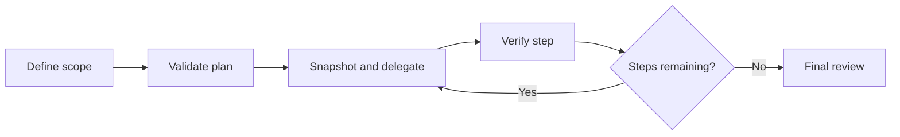

# MAKER Framework

**Plan bounded tasks. Delegate implementation. Verify results. Resume with context.**

MAKER coordinates development work in Codex through native skills, independent review, and local checkpoints. It connects each step to its requested behavior and verification evidence, so you can inspect progress and recover interrupted work.

[Codex 1.2.1](.codex-plugin/plugin.json) · [Python 3.10+](qa_server/requirements.txt) · [MIT license](LICENSE)

[Install](#install-in-codex) · [Usage](#use-maker) · [Workflow](#how-the-codex-workflow-runs) · [Documentation](#documentation)

## What you can do

Use MAKER for development tasks that benefit from explicit ownership, review, and recovery:

- Break a larger request into ordered steps with declared files and acceptance criteria.
- Delegate bounded work and review the actual changes with independent agents when the host supports them.
- Run project tests, measure coverage, and compare named test results against a baseline.
- Resume from saved plans, file snapshots, and references to context and review reports.
- Install once globally and select the target project for each QA call.

MAKER runs within your authorized chat. It does not schedule background work or guarantee error-free output. Small edits do not need a full pipeline.

## Install in Codex

You need Git, Python 3.10+, and a current Codex installation with plugin support. Keep Python on Codex’s PATH, and install your project’s test runner separately when needed.

Clone the repository and register its local marketplace:

```sh
git clone https://github.com/forsonny/maker-framework.git
cd maker-framework
python -m pip install -r qa_server/requirements.txt
codex plugin marketplace add .
```

Open Codex’s plugin directory, or enter `/plugins` in the CLI. Select the **MAKER Framework** marketplace and install **MAKER Framework**. Start a new chat in the project you want to work on.

The installation is global: the same skills and QA server work across projects without project-specific Codex configuration. Each filesystem QA call requires the target project’s absolute `working_dir`.

If `codex plugin` is unavailable, use a current CLI or the executable bundled with the desktop app. After updating this checkout, refresh or reinstall the local plugin and start a new chat to load the updated package. See [Codex setup and recovery](docs/CODEX.md) for details.

## Use MAKER

Describe the outcome and the checks that matter in ordinary language:

```text
Use MAKER to add CSV export to the reports page.
Preserve the current filters and verify that the exported rows match them.
```

The four Codex skills support these requests:

| Request | Skill |
|---|---|
| “Use MAKER to implement this task…” | `maker-framework:maker` |
| “Show MAKER status.” | `maker-framework:maker-status` |
| “Resume the MAKER task.” | `maker-framework:maker-resume` |
| “List, inspect, or clear the MAKER cache.” | `maker-framework:maker-cache` |

Your project instructions define scope, model selection, permissions, and required reviews. When native delegation is unavailable, MAKER discloses that review was performed by the same agent.

## How the Codex workflow runs

MAKER connects planning, implementation, and review through explicit checkpoints:



Each step declares its files before execution. The state helper copies those files without stashing or resetting your working tree, then records resulting hashes and supplied evidence. Critical or disputed steps can use independent candidate reasoning and bounded voting.

Project state lives under `.maker/`. Run records retain the plan location, optional context references, and solver, validator, and final-review report paths. On resume, agents inspect that context and check current files before repeating interrupted actions. A saved status records progress; it does not prove a worker is still running.

See the [workflow and state command reference](codex/skills/maker/workflow.md) for step transitions, verification contracts, and restoration rules.

## QA tools and their limits

The bundled `maker-qa` server exposes seven tools through the Model Context Protocol (MCP):

| Tool | Purpose |
|---|---|
| `ping` | Check server connectivity |
| `run_tests` | Execute tests through pytest, unittest, Jest, or Mocha |
| `get_coverage` | Measure coverage with the selected framework’s tooling |
| `check_regressions` | Compare named test results with a saved baseline |
| `generate_tests` | Create test scaffolds for further implementation |
| `check_prd_alignment` | Compare source keywords with product requirements |
| `aggregate_qa_report` | Combine supplied QA results into a report |

If automatic detection finds no supported test framework, execution tools return `status: "unavailable"` and `tests_executed: 0`. They do not launch an unrelated fallback runner or manufacture a passing or failing product test. Use the project’s existing verification route for its acceptance criteria.

Generated tests still need meaningful assertions, and keyword alignment does not verify behavior. Logic checks should explain where expected outcomes come from; interactive checks should describe the starting state, user actions, and observed outcome. Test execution and coverage run project code and its configured hooks.

The QA server uses local tooling and needs no additional model API key. See [QA configuration and direct invocation](docs/CODEX.md#qa) for runner dependencies, tool arguments, and unavailable-result semantics.

## Claude Code profile

The repository also retains the legacy Claude Code profile, with its own agents, slash commands, and hooks. Install it from Claude Code:

```text
/plugin marketplace add forsonny/maker-framework
/plugin install maker-framework@maker-framework
```

Restart Claude Code, then invoke a command such as:

```text
/maker-framework:maker "Build a file upload component"
/maker-framework:maker-status
/maker-framework:maker-resume
```

The Codex profile uses separate skills and recovery helpers. The current compatibility work did not revalidate Claude Code’s lifecycle or repair its legacy stash-based recovery; read the [compatibility audit](docs/AUDIT-2026-10-11.md) before relying on those behaviors.

## Documentation

Start with the guide for the profile you use:

| Guide | Contents |
|---|---|
| [Codex setup and recovery](docs/CODEX.md) | Global installation, usage, QA, checkpoints, and limitations |
| [Codex workflow reference](codex/skills/maker/workflow.md) | Plan format, evidence references, commands, and agent roles |
| [Compatibility audit](docs/AUDIT-2026-10-11.md) | Dated verification evidence and remaining limits |
| [Legacy Claude installation](docs/INSTALLATION.md) | Claude Code setup |
| [Legacy QA integration](docs/QA-MCP-INTEGRATION.md) | Original QA integration reference |

The Codex package lives in `.codex-plugin/`, `.agents/plugins/`, and `codex/skills/`. Shared QA code lives in `qa_server/`; the Codex launch and checkpoint helpers live in `scripts/`.

## Verify changes

Run the repository checks from its root:

```sh
python -m unittest discover -s tests -v
```

The suite exercises QA routing, project isolation, MCP communication, and state recovery using temporary projects. Optional pytest and coverage checks require their corresponding packages. The [compatibility audit](docs/AUDIT-2026-10-11.md) records the tested environment and the scope of earlier checks.

## Research and license

MAKER draws on task decomposition and multi-agent voting from [Solving a Million-Step LLM Task with Zero Errors](https://arxiv.org/abs/2511.09030). The paper’s benchmark result is not a reliability guarantee for this plugin or the software it produces.

Released under the [MIT license](LICENSE).
